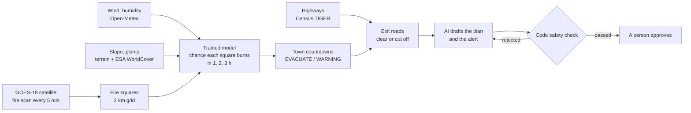
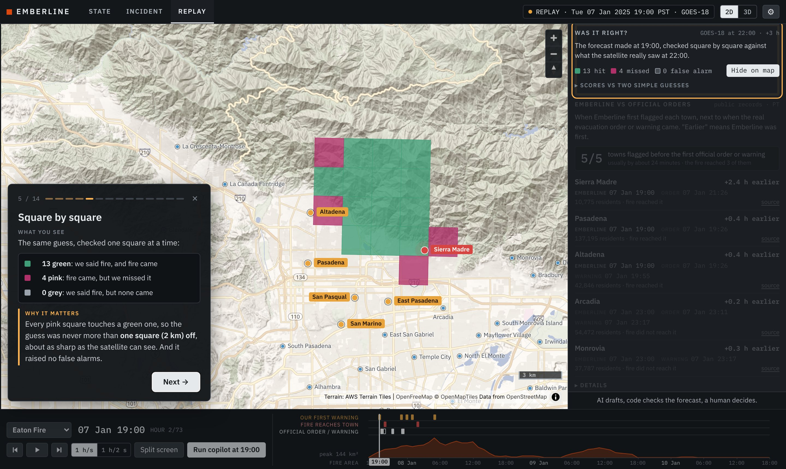

# Emberline: a wildfire copilot for California

**Track:** AI + Climate (Veritas AI Hackathon 2026) · **Team:** _add names_ · **Live demo:** _add the Vercel link_ (open it and press "Start the demo", it takes 2 minutes)

[](https://github.com/Ap9091/emberline/actions/workflows/tests.yml)

Emberline predicts where a California wildfire will spread over the next three hours, warns the towns in its path, and checks that the escape roads are still open. An AI drafts the evacuation plan, plain code checks it against the forecast, and a person makes the final call. Replaying the 2025 Eaton Fire, it flagged Sierra Madre almost two and a half hours before the official evacuation order.


## The problem

During the Eaton Fire in January 2025, the evacuation alert for west Altadena went out at 3:25 in the morning, hours after fire had already been seen in the area ([LA County investigation report](https://file.lacounty.gov/SDSInter/lac/1208708_InvestigationReportoftheEatonFireEvacuationAlerts_05-18-26_.pdf)). The difficulty in the first hours of a fire is usually not seeing it, since satellites and cameras do that well. It is knowing where the fire is going next, which communities should leave, and which roads will still be open when they do. Those decisions are made under pressure by an incident commander or a county emergency manager, often with the fire moving faster than the information around them.

## What we built

Emberline is a web app for that person. It has three views:

- **STATE**: every fire in California from the latest weather satellite scan, ranked by how many people are near it, how big it is and where the wind is pushing it.
- **INCIDENT**: one fire up close. The model's forecast for the next 1, 2 and 3 hours, a countdown for every nearby town (EVACUATE, WARNING or MONITOR), and the main highways out of each town, marked clear or about to be cut off.
- **REPLAY**: three real fires (Park 2024, Eaton 2025, Palisades 2025) played back hour by hour, with what the satellite really saw afterwards, square by square, and the real evacuation orders next to ours.

On top of that, an AI copilot (Gemini, or Claude when a key is set) writes a short briefing, an evacuation plan and the text of a phone alert, and an "Ask Emberline" guide (Claude Sonnet 5.5) answers questions and moves the app to the answer. A two-minute guided demo explains everything in plain words, for someone who knows nothing about wildfires.

## What we added (our own idea)

The idea was inspired by [ContainOS](https://devpost.com/software/containos) (TreeHacks 2026), a decision-support tool for fire crews built on fire physics and a multi-agent AI. We took the same goal in a different direction. Firstly, we chose our own user (the person deciding evacuations, not the crews fighting the fire). Next, we built our own dataset from the GOES weather satellite and trained a forecast model on it, rather than simulating physics. Finally, we put the AI behind a code check, so it can never send people down a road the forecast says is about to burn.

As far as we could find, the pieces exist separately but nothing joins them:

| | Shows the fire now | Predicts spread | Tells towns to leave | Checks the escape roads | AI plan checked by code | Graded against real orders |
|---|:-:|:-:|:-:|:-:|:-:|:-:|
| Fire apps (for example [Watch Duty](https://www.watchduty.org/)) | ✓ | announced | shows official orders | | | |
| Research spread models (for example [this GOES thesis](https://mountainscholar.org/items/b50099d2-bb8f-411c-9950-386416b22f80/full)) | | ✓ | | | | |
| AI evacuation research (for example [FLARE](https://arxiv.org/abs/2502.17701)) | | | predicts who leaves | | | |
| **Emberline** | ✓ | ✓ | ✓ | ✓ | ✓ | ✓ |

## How it works



1. **Data.** We took 70 large California fires from 2018 to 2025 and, for each, 74 hours of GOES-16/17/18 fire detections on a 2 km grid (80 by 80 km around the fire), hourly weather at the fire's start point, slope and elevation, and land cover. Each 2 km square within 6 km of the fire, at each hour, is one example: 355,483 in total.
2. **Model.** A logistic regression predicts the chance that each square is burning an hour later, then rolls forward to two and three hours. We also trained gradient-boosted trees. On the tuning fires they scored a little better square by square but warned fewer towns (87% against 93%), and the decision we care about is towns, so we kept the simpler model, which is also easier to explain.
3. **Split by time.** Training used 40 fires from 2018 to 2022 (237,225 examples), every setting was chosen on 12 fires from 2023 and on cross-validation by fire, and the test used 18 fires from 2024 and 2025 that the model never saw.
4. **Decisions.** A town is EVACUATE when the forecast fire reaches it within an hour and WARNING when it could arrive within three. Each town's main highways are checked against the forecast. The AI's plan is rejected if it misses a town on EVACUATE, names a road that does not exist, or uses a road the forecast fire crosses within the hour; if every road is blocked, the decision goes to a person instead.

## Results

All numbers below come from `results/` and are checked by the tests in `tests/`. The test fires are 18 California fires from 2024 and 2025 that the model never saw, compared with two simple forecasts, as the track asks.

| On 18 unseen fires | Fire stays put | Fire grows 1 km/h | **Emberline** |
|---|:-:|:-:|:-:|
| Towns warned before the fire reached them | 0 of 20 | 18 of 20 (90%) | **18 of 20 (90%)** |
| Average warning time | none | 2.5 h | **2.8 h** |
| False alarms (town-hours per fire-day) | 0 | 23.4 | 30.1 |
| Spotting newly burning squares at +1 h (F1, strict / within 2 km) | 0 / 0 | 0.14 / 0.24 | **0.32 / 0.41** |
| Overlap with the real fire at +1 / +2 / +3 h (IoU) | **0.70 / 0.56 / 0.47** | 0.31 / 0.19 / 0.17 | 0.68 / 0.54 / 0.45 |

**Against real evacuation orders.** On the three replay fires, nine towns have published order or warning times. Emberline flagged eight of them first, including all five towns the fire actually reached, by between 0.4 and 2.4 hours (Sierra Madre 2.4 h, Chico 1.8 h, Cohasset 0.9 h, Pasadena and Altadena 0.4 h each). The one it flagged later was Butte Meadows, by an hour, and the fire never reached it.

**Would it work in a real fire?** Three checks, with the same model and no retraining:

- **Forecast weather.** The test above used weather records reconstructed after each fire (ERA5). Re-run with the archived forecast that existed at the time, and with the forecast from a day before, Emberline still warned 18 of 20 towns 2.8 hours early, and Sierra Madre was still flagged 2.4 hours before its order ([results/weather_stress.md](results/weather_stress.md)).
- **False alarms are mostly "get ready".** Of the 1,301 false-alarm town-hours, 98.5% were WARNING and only 19 were EVACUATE ([results/false_alarms.json](results/false_alarms.json)).
- **Speed.** A new satellite scan becomes a forecast with town and road checks in under a second of model time, and about four seconds including the download and a typical AI answer ([results/speed.json](results/speed.json)). The satellite publishes a new scan every five minutes.



## Where it fails, and why

It would be misleading to present these results without their limits, so we list them plainly.

- **Fire shape.** For the overall shape of the fire, Emberline is about as good as assuming the fire stays where it is (0.45 against 0.47 at three hours). Its advantage is in spotting new spread and warning towns, not in drawing the perimeter.
- **More false alarms than the simple rule.** This was a choice: the warning threshold was set on the tuning fires to miss as few towns as possible, since a missed town costs more than an extra warning.
- **The satellite is blurry.** GOES pixels are 2 to 4 km wide, and smoke, cloud and night can hide fire, so the model can be off by a square and can miss ember jumps longer than about 6 km.
- **One weather point per fire.** Local winds such as the Santa Ana winds funnelled through canyons are underestimated.
- **A small test set.** Eighteen fires and twenty towns is a reasonable sample for a hackathon, but it is not enough to promise these numbers on every fire.
- **Problems we found in our own work.** Our first test run exposed three bugs (other fires inside a fire's box, one cut-off hiding new spread, and too few towns to tune on); we fixed them, re-ran the test once, and kept the first run's results ([results/phase3_run1_results_table.md](results/phase3_run1_results_table.md)). Later we found that the what-if view compared a trimmed replay against a full model run, which made a wind change look bigger than it is (6 to 20 towns instead of 10 to 20); it now compares like with like. The replay files keep only forecast chances of 5% and above, so the replay can show a WARNING up to an hour later than the model gave it; this makes the replay slightly conservative, and every score above uses the full model.

Emberline is a research project. In a real fire, follow official orders.

## What we'd do next

- Use official evacuation zones instead of town centres, since most orders are issued by zone.
- Use finer data: 3 km forecast winds instead of one point per fire, and the 375 m VIIRS satellite passes when they are available.
- Add "leave by" times for each town, based on when the forecast fire is expected to reach each escape road.
- Run it alongside a county emergency office during a live fire, without sending anything, to see whether its warnings arrive early enough to matter.

## Questions a judge might ask

- **How live is it?** The full app reads the newest GOES-18 scan every five minutes. The hosted demo is a saved snapshot of the same pipeline, so it opens instantly without a server.
- **How accurate is it?** On 18 unseen fires it warned 90% of the towns the fire reached, about three hours early, and it held up with forecast weather. It is no better than "stays put" at the overall fire shape.
- **What if the AI is wrong?** The AI never acts alone. Code rejects any plan that misses a town in danger or uses a road the forecast fire crosses within the hour, and nothing is sent until a person approves it.
- **Why such a simple model?** It warned more towns than the boosted trees on the tuning fires, its inputs can be explained in one sentence each, and it runs in under a second.
- **How is it different from ContainOS?** ContainOS supports fire crews with physics and AI agents. Emberline supports the evacuation decision with a model trained and tested on real satellite data, checks its AI with code, and grades itself against the real evacuation orders.

## Sources

Data: [GOES-16/17/18 fire product on AWS](https://registry.opendata.aws/noaa-goes/) (NOAA), [NASA FIRMS](https://firms.modaps.eosdis.nasa.gov/), [Open-Meteo](https://open-meteo.com/) (ERA5 archive, historical forecasts, previous runs), [AWS Terrain Tiles](https://registry.opendata.aws/terrain-tiles/), [ESA WorldCover](https://esa-worldcover.org/), [US Census](https://www.census.gov/) (places, 2024 population, TIGER/Line roads, cartographic boundaries), [CAL FIRE incidents](https://www.fire.ca.gov/incidents). Evacuation times: [LA County report on the Eaton Fire alerts](https://file.lacounty.gov/SDSInter/lac/1208708_InvestigationReportoftheEatonFireEvacuationAlerts_05-18-26_.pdf), the [LAFD Palisades after-action report](https://lafd.org/sites/default/files/pdf_files/Palisades_AARR_10_08_2025_final.pdf), and the Butte County Sheriff, Santa Monica and news posts listed in [data/evac_orders.csv](data/evac_orders.csv), one source link per row. Tools: scikit-learn, FastAPI, MapLibre, OpenFreeMap / OpenStreetMap, Gemini (Google) and Claude (Anthropic). Inspiration: [ContainOS](https://devpost.com/software/containos). The full list, with licences and how each source is used, is in [data_sources.md](data_sources.md).

---

## Run it yourself

```bash
git clone https://github.com/Ap9091/emberline.git
cd emberline
python3.11 -m venv .venv && .venv/bin/pip install -r requirements.txt
app/run.sh
```

Then open http://localhost:8000. The AI parts are optional: put `GEMINI_API_KEY=...` or `ANTHROPIC_API_KEY=...` in a `.env` file (it is ignored by git); without one, the app runs and says "AI offline, forecast only".

To run the tests (32 of them: the safety check, every number the demo and this README state, the in-browser what-if against the Python model, the weather stress test and the assistant's rules):

```bash
.venv/bin/python -m pytest -q tests
```

## What is where

| Folder | What it holds |
|---|---|
| `src/` | The pipeline: `p1`/`p2` build the dataset from the satellite, weather, terrain and towns; `p3_core.py` is the model, forecast and scoring; `p4_*.py` are the real-world checks |
| `notebooks/03_train.ipynb` | Training, tuning and the test, saved with outputs |
| `results/` | Every number in this README (`metrics.json`, `results_table.md`, `weather_stress.md`, ...) and the replay files |
| `models/` | The trained model |
| `app/` | The web app: `backend/` (FastAPI, situations, roads, copilot, safety check), `static/` (the page), `assistant/` (the guide's knowledge) |
| `site/` | The hosted version (static files plus one serverless function for the guide) |
| `tests/` | The tests, also run on every push by GitHub Actions |
| `data/` | The processed dataset, the fire list, the evacuation orders with sources |
