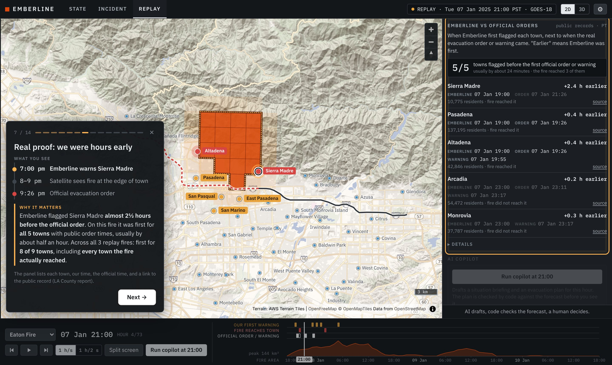
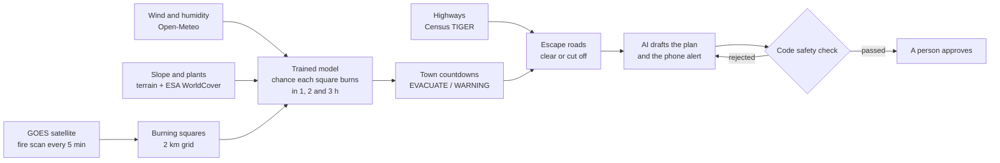
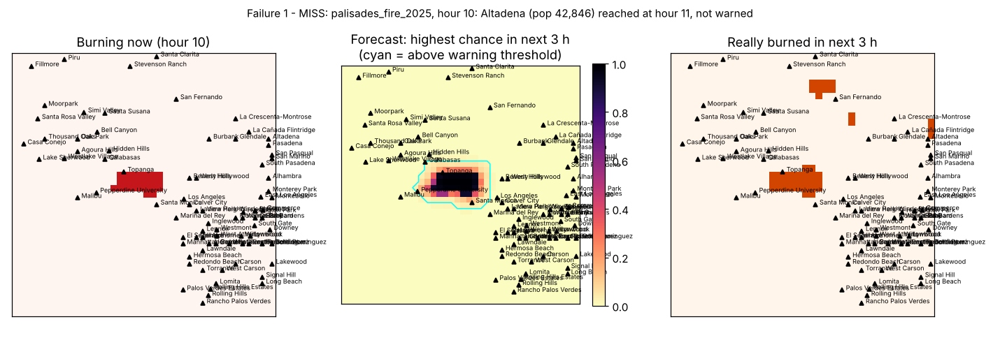

# Emberline: a wildfire copilot for California

**Track:** Climate · **Team:** Aryan Thakrar, Sneh Patel, Anirudhan Illayaraja · **Live demo:** _add the Vercel link_ (press "Start the demo", it takes 2 minutes) · **Video:** _add the link_

[](https://github.com/Ap9091/emberline/actions/workflows/tests.yml)

> **Main takeaway:** tested on 18 California fires it had never seen, Emberline warned 18 of the 20 towns those fires reached, about three hours before the fire arrived, and on the 2025 Eaton Fire it flagged Sierra Madre almost two and a half hours before the official evacuation order.



## The problem

Hotter and drier conditions are making California's wildfires spread faster, and the people who decide which towns should leave often know less about where a fire is going than the fire itself shows. During the Eaton Fire in January 2025, the evacuation alert for west Altadena went out at 3:25 in the morning, hours after fire had already been seen in the area ([LA County investigation report](https://file.lacounty.gov/SDSInter/lac/1208708_InvestigationReportoftheEatonFireEvacuationAlerts_05-18-26_.pdf)). Seeing a fire is no longer the hard part, since satellites do that every five minutes; the hard part is knowing where it goes next, who should leave, and which roads will still be open.

## What we built

Emberline is for one person: the county emergency manager or incident commander deciding evacuations in the first hours of a fire. They would open it when a new fire is reported, and keep it open as the fire grows.

**What goes in:** the fire as the GOES-18 weather satellite sees it every five minutes, the wind and humidity, the slope of the land, what is growing on it, where the towns are, and the main highways out of each town.

**What comes out:** a forecast of where the fire will be in 1, 2 and 3 hours, a status for every nearby town (EVACUATE, WARNING or MONITOR, with a countdown), whether each escape road is clear or about to be cut off, and an evacuation plan drafted by an AI and checked by plain code before a person approves it.

**A real input and its result.** At 7 pm on January 7, 2025, the Eaton Fire covered 44 km² (11 squares of 2 km), the wind was 29 km/h from the north-northeast with gusts near 100 km/h, and the humidity was 24%. Emberline forecast 52 km² burning by 10 pm, told Sierra Madre (10,775 people) to evacuate, put Pasadena, Altadena, San Marino, East Pasadena and San Pasqual on WARNING, and showed both directions of the I-210 out of Sierra Madre as clear. The official order for Sierra Madre came at 9:26 pm.

The app has three views (STATE: all of California, INCIDENT: one fire up close, REPLAY: three real fires hour by hour), a two-minute guided demo written for someone who knows nothing about wildfires, and an "Ask Emberline" guide that answers questions in plain words and moves the app to the answer.

## What we added

**Our own idea.** It was inspired by [ContainOS](https://devpost.com/software/containos) (TreeHacks 2026), a decision-support tool for fire crews built on fire physics and a multi-agent AI, and we took the same goal somewhere different.

- **Our own user:** the person deciding evacuations, not the crews fighting the fire.
- **Our own data:** we built a dataset ourselves from the raw GOES satellite files for 70 California fires, and trained and tested our own forecast model on it.
- **Our own question:** does the forecast hold up in the situations that matter? We tested it against the real evacuation orders, with the weather forecast people really had at the time, and against an AI that might suggest a road the fire is about to cross.

As far as we could find, the pieces exist separately, but nothing joins them:

| | Shows the fire now | Predicts spread | Tells towns to leave | Checks the escape roads | AI plan checked by code | Graded against real orders |
|---|:-:|:-:|:-:|:-:|:-:|:-:|
| Fire apps (for example [Watch Duty](https://www.watchduty.org/)) | ✓ | announced | shows official orders | | | |
| Research spread models (for example [this GOES thesis](https://mountainscholar.org/items/b50099d2-bb8f-411c-9950-386416b22f80/full)) | | ✓ | | | | |
| AI evacuation research (for example [FLARE](https://arxiv.org/abs/2502.17701)) | | | predicts who leaves | | | |
| **Emberline** | ✓ | ✓ | ✓ | ✓ | ✓ | ✓ |

## How it works



**Data.** We picked the 70 largest California fires from 2018 to 2025 that the GOES satellites could see, using CAL FIRE's incident list and NASA FIRMS. For each one, we took 74 hours of GOES-16/17/18 fire scans, one every five minutes, over an 80 by 80 km box split into 2 km squares, along with hourly weather, elevation and slope, land cover, and Census towns and roads. Each 2 km square within 6 km of the fire, at each hour, is one example: 355,483 in total. The label is simple: was that square burning an hour later? Cleaning took most of the work:

1. **Pixel footprints.** California is far from the point under the satellite, so each GOES pixel covers a slanted patch of about 2.2 by 3 km (GOES-West) or 3.9 by 4.3 km (GOES-East). Marking only the square under a pixel's centre left whole rows of squares that could never burn, so we mark every square whose centre falls inside the pixel's real footprint.
2. **One fire per box.** An 80 km box can hold more than one fire (the Palisades box also contains the Eaton Fire, 35 km east). We follow our fire outward from its CAL FIRE start point and remove everything else in the box.
3. **Short gaps only.** Smoke, cloud or a missing file can hide a fire that is still burning, so we fill one-hour gaps from the hours on either side and mark them as filled. Filled hours are never used as answers when we train or test, and gaps of two hours or more are left empty.
4. **No looking ahead.** Every feature for hour h uses only what was known by hour h, so the model can never see the answer it is asked for.

**Model.** A logistic regression with 39 inputs in five groups: the fire itself (burning now, burned before, distance to the fire, burning neighbours, fire size, growth and how much heat it gives off), time (hours since start, hour of day, night), weather (wind speed and gusts, humidity, temperature, and whether the square is downwind), terrain (elevation, slope, uphill from the fire) and land cover (eleven ESA WorldCover classes). It gives the chance that each square is burning in an hour, and we roll that forward to two and three hours by treating the forecast as the new fire. We chose it over gradient-boosted trees, which we also trained: on the tuning fires the trees scored a little better square by square, but they warned fewer towns (87% against 93%), and towns are the decision we care about. The simpler model is also easier to explain and runs in under a second.

**How we trained and tested it.** We split the fires by time, never shuffling them: 40 fires from 2018 to 2022 for training (237,225 examples), 12 fires from 2023 plus cross-validation by fire for choosing every setting, and 18 fires from 2024 and 2025 for the test. Three settings were chosen on the tuning fires and never on the test: the chance at which a square counts as burning (0.625 for squares that have burned before, 0.275 for new ones) and the chance near a town that triggers a WARNING (0.01, set so that about 9 in 10 towns are caught). Our first test run exposed three bugs, so we fixed them, re-ran the test once, and kept the first run's results in the repo.

## Results

All results are on the 18 test fires from 2024 and 2025, which the model never saw. We compare against **persistence**, the simple forecast the brief asks for ("the fire in three hours will look like the fire now"), and a second simple rule where every edge of the fire grows one kilometre an hour.

| On 18 unseen fires | Persistence (fire stays put) | Grows 1 km/h | **Emberline** |
|---|:-:|:-:|:-:|
| Towns warned before the fire reached them | 0 of 20 | 18 of 20 (90%) | **18 of 20 (90%)** |
| Average warning time | none | 2.5 h | **2.8 h** |
| False alarms (town-hours per fire-day) | 0 | 23.4 | 30.1 |
| Spotting newly burning squares at +1 h (F1, strict / within 2 km) | 0 / 0 | 0.14 / 0.24 | **0.32 / 0.41** |
| Overlap with the real fire at +1 / +2 / +3 h (IoU) | **0.70 / 0.56 / 0.47** | 0.31 / 0.19 / 0.17 | 0.68 / 0.54 / 0.45 |

Persistence cannot warn anyone, since it never predicts new fire, and it is hard to beat at the overall shape. Emberline's value is in spotting new spread (about 1.7 times better than the growth rule) and in turning that into town warnings.

**From prediction to decision.** On the three replay fires, nine towns have published evacuation order or warning times. Emberline flagged eight of them first, including all five towns the fire actually reached, by between 0.4 and 2.4 hours (Sierra Madre 2.4 h, Chico 1.8 h, Cohasset 0.9 h, Pasadena and Altadena 0.4 h each). The one it flagged later was Butte Meadows, by an hour, and the fire never reached it.

**Does it hold up?** Three checks with the same model and no retraining:

- **With the forecast people really had.** The test used weather records made after each fire (ERA5). Re-run with the archived weather forecast from the time, and with the forecast from a day earlier, it still warned 18 of 20 towns 2.8 hours early, and Sierra Madre was still flagged 2.4 hours before its order ([results/weather_stress.md](results/weather_stress.md)).
- **Its false alarms are mostly "get ready".** Of 1,301 false-alarm town-hours, 98.5% were WARNING; only 19 were EVACUATE ([results/false_alarms.json](results/false_alarms.json)).
- **It is fast enough.** A new scan becomes a forecast with town and road checks in under a second of model time, about four seconds with the download and a typical AI answer ([results/speed.json](results/speed.json)); a new scan arrives every five minutes.

**What affects its accuracy.** Wind matters most: without the wind inputs, the model's skill at ranking new burning squares on the test fires dropped by about 20%, while removing terrain made almost no difference (measured with the boosted-tree version). Accuracy is lower at night (new-square F1 0.29 against 0.42 by day), when the fire is small (0.37 against 0.42 for large fires, with far more false alarms), and in extreme gusts, when nearly every square near the fire passes the low warning threshold.

**Where it fails, and why.** The two towns it missed, Bell Canyon and Hidden Hills, were reached on the afternoon of January 9, 2025, by fire that appeared 13 km from the Palisades Fire's edge just as the wind turned by about 70 degrees. The time and place match the Kenneth Fire, a separate fire that started near West Hills that afternoon. Our 6 km tracker joined it to the Palisades Fire because GOES pixels are coarse, and no spread model can forecast a new ignition, so this is mostly a tracking error rather than a forecast error.



The other limits, plainly:

- For the overall shape of the fire it only ties persistence (0.45 against 0.47 at three hours).
- It gives more false alarms than the growth rule, by choice: missing a town costs more than an extra warning. If we tune it to the growth rule's false-alarm rate, it warns 85% of towns instead of 90%, so on town warnings alone it does not beat the simple rule yet.
- GOES pixels are 2 to 4 km wide, smoke and night hide fire, one weather point per fire underestimates canyon winds like the Santa Ana, and ember jumps longer than about 6 km are missed.
- Big cities are one point each, so Los Angeles can be warned when fire is inside the city limits but far from its centre.
- Eighteen fires and twenty towns is a reasonable sample for a weekend, but not enough to promise these numbers everywhere.
- Two of our own mistakes, both fixed: the what-if view once compared a trimmed replay with a full model run, which made a wind change look bigger (6 to 20 towns instead of 10 to 20), and the replay files keep only forecast chances of 5% and above, so the replay can show a WARNING up to an hour later than the model gave it. Every score above uses the full model.

Emberline is a research prototype. In a real fire, follow official orders.

## What we'd do next

1. **Use official evacuation zones instead of town centres**, since counties issue orders by zone, and add a "leave by" time for each zone from when the forecast fire reaches each escape road.
2. **Run it beside a county emergency office during a live fire**, without sending anything, to see whether its warnings arrive early enough to change a decision; with that, finer winds (3 km instead of one point per fire) and VIIRS satellite passes to separate nearby fires.

## Sources

**Datasets.** [GOES-16/17/18 fire product on AWS](https://registry.opendata.aws/noaa-goes/) (NOAA), [NASA FIRMS](https://firms.modaps.eosdis.nasa.gov/), [Open-Meteo](https://open-meteo.com/) (ERA5 archive, historical forecasts and previous runs), [AWS Terrain Tiles](https://registry.opendata.aws/terrain-tiles/), [ESA WorldCover](https://esa-worldcover.org/), [US Census](https://www.census.gov/) (places, 2024 population, TIGER/Line roads, state and county boundaries), [CAL FIRE incidents](https://www.fire.ca.gov/incidents). **Evacuation times:** [LA County report on the Eaton Fire alerts](https://file.lacounty.gov/SDSInter/lac/1208708_InvestigationReportoftheEatonFireEvacuationAlerts_05-18-26_.pdf), the [LAFD Palisades after-action report](https://lafd.org/sites/default/files/pdf_files/Palisades_AARR_10_08_2025_final.pdf), and Butte County Sheriff, City of Santa Monica and news posts, one link per row in [data/evac_orders.csv](data/evac_orders.csv).

**Models and libraries.** No pretrained models for the forecast: we trained our own with [scikit-learn](https://scikit-learn.org/). Also pandas, xarray, s3fs, rasterio, pyproj, [FastAPI](https://fastapi.tiangolo.com/), [MapLibre GL JS](https://maplibre.org/) and [OpenFreeMap](https://openfreemap.org/) / OpenStreetMap for the map.

**AI tools.** [Claude Code](https://www.anthropic.com/claude-code) (Anthropic) helped us write and debug the code. [Gemini](https://ai.google.dev/) Flash (Google) generated the copilot's briefings, plans and alerts that are saved on the website. [Claude Sonnet 5.5](https://www.anthropic.com/claude) (Anthropic) runs the "Ask Emberline" guide.

**Inspiration.** [ContainOS](https://devpost.com/software/containos). The full list, with licences and how each source is used, is in [data_sources.md](data_sources.md).

---

## How this meets the brief

| The brief asks | Where it is |
|---|---|
| **Technical quality:** a baseline, results on unseen test data, where it fails | Results table (persistence and a growth rule), 18 test fires from 2024-25, "Where it fails, and why" with an example; 32 automated tests ([tests/](tests/)) |
| **Impact:** who it helps and what would change for them | The county emergency manager; towns warned 2.8 h before the fire, and earlier than the official order in 8 of 9 towns |
| **Creativity:** a known technique on an unusual dataset, question or user | Logistic regression on a dataset we built from raw satellite files; an AI plan checked by code; graded against real evacuation orders |
| **Clarity:** understood in two minutes, one main takeaway | The takeaway at the top, the two-minute guided demo in the app, the video |
| **Climate track:** a fair comparison with a simple forecast | Persistence ("stays put") and a growth rule, scored the same way on the same fires |
| **Climate track:** a link between the prediction and a decision | Town statuses, escape roads and the evacuation plan, made by the emergency manager |
| **Climate track:** a test period the model never saw | Trained on 2018-22, tuned on 2023, tested on 2024-25, never shuffled |
| **Climate track:** a small project tied to a real place | California only, told through the Eaton Fire in Los Angeles |

## Questions a judge might ask

- **How live is it?** The full app reads the newest GOES-18 scan every five minutes. The hosted demo is a saved snapshot of the same pipeline, so it opens instantly without a server.
- **How accurate is it?** On 18 unseen fires it warned 90% of the towns the fire reached, about three hours early, and it held up with forecast weather. For the overall shape of the fire it only ties persistence.
- **What if the AI is wrong?** The AI never acts on its own. Code rejects any plan that leaves out a town on EVACUATE, names a road that does not exist, or uses a road the forecast fire crosses within the hour, and nothing is sent until a person approves it.
- **Why such a simple model?** It warned more towns than the boosted trees on the tuning fires, each input can be explained in a sentence, and it runs in under a second.
- **How is it different from ContainOS?** ContainOS supports fire crews with physics and AI agents. Emberline supports the evacuation decision with a model trained and tested on real satellite data, checks its AI with code, and grades itself against the real evacuation orders.

## Run it yourself

```bash
git clone https://github.com/Ap9091/emberline.git
cd emberline
python3.11 -m venv .venv && .venv/bin/pip install -r requirements.txt
app/run.sh
```

Then open http://localhost:8000. The AI parts are optional: put `GEMINI_API_KEY=...` or `ANTHROPIC_API_KEY=...` in a `.env` file (git ignores it); without one, the app runs and shows "AI offline, forecast only".

The 32 tests cover the safety check, every number the demo and this README state, the in-browser what-if against the Python model, the weather stress test and the guide's rules:

```bash
.venv/bin/python -m pytest -q tests
```

The model was trained in [notebooks/03_train.ipynb](notebooks/03_train.ipynb), saved with its outputs.

## What is where

| Folder | What it holds |
|---|---|
| `src/` | The pipeline: `p1`/`p2` build the dataset (satellite, weather, terrain, towns, tracking); `p3_core.py` is the model, forecast and scoring; `p4_*.py` are the stress test, false-alarm breakdown and speed test |
| `notebooks/` | Training, tuning and the test, with outputs |
| `results/` | Every number in this README, the replay files and the failure maps |
| `models/` | The trained model |
| `app/` | The web app: `backend/` (FastAPI, forecasts, roads, copilot, safety check), `static/` (the page), `assistant/` (the guide's knowledge) |
| `site/` | The hosted version, plus one serverless function for the guide |
| `tests/` | The tests, also run by GitHub Actions on every push |
| `data/` | The processed dataset, the fire list, and the evacuation orders with sources |
